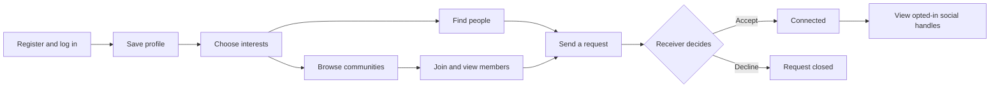

# Connore Simple

Connore helps college students meet through shared interests. Create a profile,
choose interests, find people or communities, and send a connection request.
Social handles become visible only after acceptance and only when their owner
enables sharing.

Open **http://localhost:8081/**. This version uses plain forms, text links and
lists. It has no animations, dashboard, decorative effects or external fonts.
After login, use People, Communities, Requests and Profile.

This is a separate project in `E:\Connore-Simple`. The original version remains
in `E:\Connore` on port 8080. Both use the same local MySQL database, so profile,
interest and connection changes appear in both. They use separate session
cookies so logging in to one version does not log you out of the other.
The original local copy already has its database credentials and JDBC driver.
Fresh clones need their own `.env` settings and Connector/J JAR, as described
below. Launch the configured project with `start-local.bat`.

## Sharing with the group

The GitHub repository shares the source code. The website needs the Java server
and MySQL running. A temporary Cloudflare HTTPS link can share the running local
website with the group; the laptop, Java server, MySQL and tunnel must stay
running. Restarting the temporary tunnel gives it a new link.

## Run locally

Requirements: JDK 17 or later, MySQL 8.0.16 or later, and the MySQL Connector/J
JAR in `lib/`. Node.js is optional and used for frontend checks.
The Windows launchers find Java through `JAVA_HOME`, PATH, or an installed JDK
under `Program Files/Java`.

1. Copy `.env.example` to `.env` and enter your local MySQL credentials.
2. For a **new database only**, execute `sql/schema.sql` in MySQL Workbench.
   Keep an existing Connore database as it is.
3. Load the compact catalog:

   ```powershell
   java Build.java
   java -cp "out;lib/*" com.connore.tools.InterestCatalog --sync
   ```

4. Run `start-local.bat` on Windows or `bash run.sh` on macOS/Linux.
5. Register with your college email, log in, and save your profile.

On macOS/Linux, replace `out;lib/*` with `out:lib/*` in Java classpaths.
Leave the server process running while using the website. Press Ctrl+C to stop.

## Configuration

| Variable | Purpose | Default |
| --- | --- | --- |
| `DB_URL` | MySQL JDBC URL | Local `connore` database |
| `DB_USER` | MySQL user | `root` |
| `DB_PASSWORD` | MySQL password | Empty |
| `COLLEGE_DOMAIN` | Allowed registration domain | `sitpune.edu.in` |
| `SERVER_HOST` | Address to bind | `127.0.0.1` |
| `SERVER_PORT` | Local HTTP port | `8081` |
| `SESSION_MINUTES` | Session inactivity timeout | `30` |

Process environment variables override `.env`. The old `config.properties`
format remains a fallback for existing installations. `.env` and local
credentials are ignored by Git. Commit `.env.example`, which has no password.
Use quotes around values containing spaces or `#`; double quotes support
escaped quotes, backslashes and newline characters. Values are not expanded
as shell commands or environment-variable expressions.

## Website flow



Requests expire after 48 hours. Students choose what to share; joining a
community and selecting an interest are separate actions.

## Project structure

```text
Connore-Simple/
├── .env.example                 Safe configuration template
├── Build.java                   JDK-only build entry point
├── run.bat / run.sh             Local server launchers
├── dist/                       Browser frontend
│   ├── index.html
│   ├── css/site.css            Plain responsive styles
│   └── js/                     Configuration, API client and application
├── src/main/java/com/connore/
│   ├── Main.java               Startup and database check
│   ├── web/                    HTTP routing, endpoints and sessions
│   ├── service/                Validation and business rules
│   ├── dao/                    Prepared SQL statements
│   ├── model/                  Entities and connection states
│   ├── matching/               Shared-interest scoring
│   ├── util/                   Configuration, JDBC, JSON and hashing
│   └── tools/                  Interest catalog management
├── sql/                        13-table schema and 48-interest catalog
├── test/                       Java and browser-behavior checks
├── tools/                      Windows Java launcher and catalog loader
├── scripts/                    Repository checks and source packaging
├── docs/                       Architecture and database diagrams
└── lib/                        Locally supplied JDBC driver
```

The server follows **HTTP route → session filter → endpoint → service → DAO →
MySQL**. See [architecture and API flow](docs/architecture.md) and
[database design](docs/database-design.md). The editable ER/EER diagrams are in
[`docs/diagrams/Connore_ER_EER.drawio`](docs/diagrams/Connore_ER_EER.drawio).

## Interest catalog

The visible catalog contains **48 interests in 8 categories**, defined in
`sql/interest-catalog.tsv`. Select interests using the checkboxes in Profile.

`--sync` makes that file the active catalog. It reuses existing interest IDs,
groups entries into the listed categories, and creates missing communities.
Out-of-list interests are marked inactive rather than deleted. Their selections,
community memberships and connection history are retained. Inactive interests
do not appear in new suggestions or the community browser.

Use `--check` to inspect the current catalog and `--verify` to confirm it matches
the file. Repeating `--sync` does not create duplicates. To change the list,
edit the TSV and synchronize again. Catalog synchronization does not register
accounts or automatically select interests or join communities for students.

## Verify

```powershell
java Build.java test
java -cp out ConfigTest
java -cp out CoreTest
java -cp out FilterTest
java -cp out CatalogTest
node --test test/ui.test.cjs
```

These checks need no database. With the catalog loaded, `java -cp "out;lib/*"
CatalogDbTest` checks JDBC catalog behavior and rolls back its temporary records.
The broader `IntegrationTest` requires a separate, empty database ending in
`_test`; use `test-db.example.properties` as the configuration template and run
`java -cp "out;lib/*" IntegrationTest test-db.properties`. Never use a populated
student database for that integration test.

## Git and publishing

The repository excludes `.env`, local credentials, dependency JARs, compiled
output, logs, IDE state, reports and private archives. `dist/` is frontend
source and is tracked. GitHub Actions runs the Java and frontend checks.

Before committing, run `node scripts/check-repository.cjs` after staging.
After creating an empty remote repository:

```sh
git remote add origin <repository-url>
git push -u origin main
```

The local project does not publish itself. To create a ZIP containing only
committed source, run `node scripts/package-source.cjs`.
