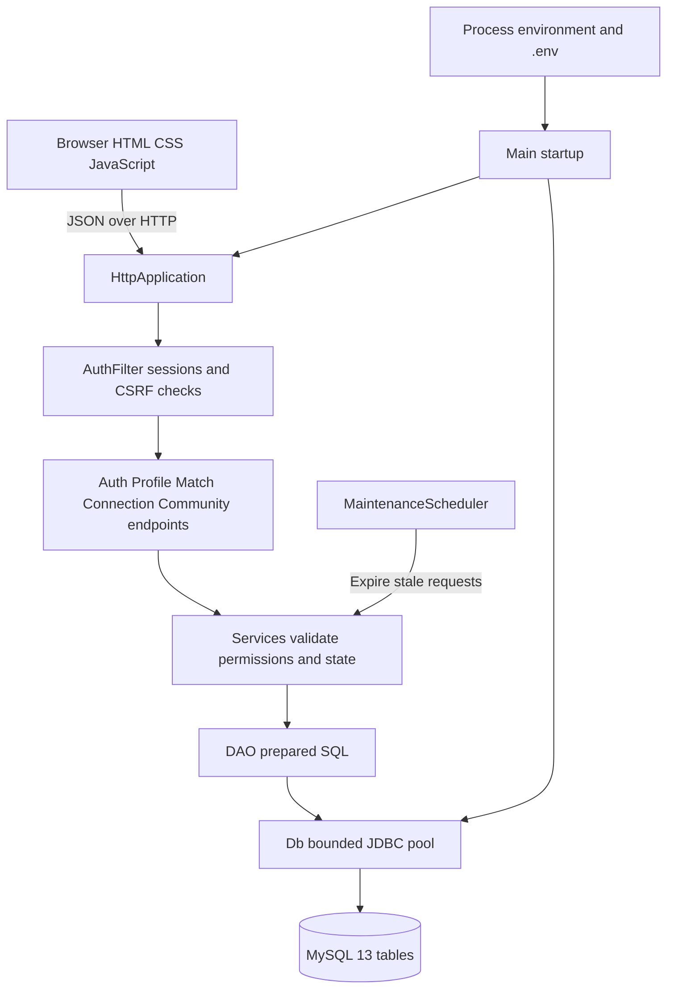
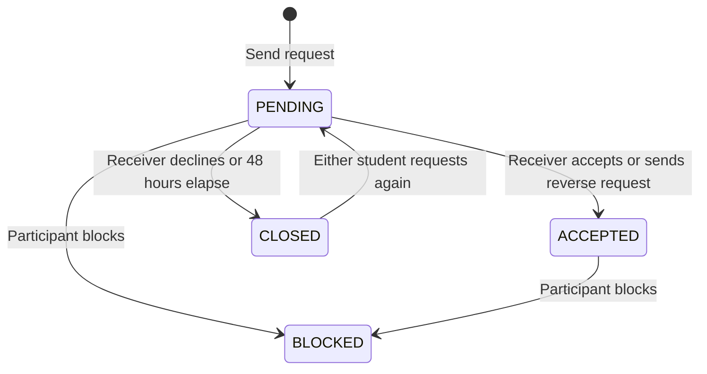

# Connore structure and flow

The simple frontend is served at `http://localhost:8081/`. Login leads directly
to People once a profile is saved; new accounts first complete Profile. The
four ordinary navigation links open People, Communities, Requests and Profile.
Registration is the only additional account screen. There is no animation code
or presentation page. The original project at `E:\Connore` is independent.

## Runtime layers

`Main` loads configuration, checks database access, and starts `HttpApplication`.
Static frontend files come from `dist`. The API returns JSON and uses an
HttpOnly `CONNORE_SIMPLE_SESSION` cookie, separate from the original project's
cookie. Write requests require the application request header
and a matching origin. Java services perform authorization and validation;
DAOs execute parameterized queries through `Db`.

## API responsibilities

All paths below start with `/api`. Except for registration and login, requests
require an authenticated session. Profile-dependent actions also require a
saved student profile.

| Area | Routes | Responsibility |
| --- | --- | --- |
| Account | `POST /auth/register`, `/auth/login`, `/auth/logout`; `GET /session` | Registration, sessions and logout |
| Profile | `GET/PUT /profile`; `PUT /profile/privacy` | Introduction and visibility settings |
| Interests | `GET /interests`; `GET/POST /profile/interests`; `DELETE /profile/interests/{id}` | Active catalog and personal selections |
| Social handles | `GET/POST /profile/social-links`; `PUT /profile/social-links/{id}` | Private handles and sharing preference |
| Suggestions | `GET /matches` | Rank eligible profiles by approved shared interests |
| Connections | `GET/POST /connections`; `POST /connections/{id}/respond`, `/connections/{id}/block` | Requests, responses, connections and blocking |
| Communities | `GET /communities`, `/communities/{id}/members`; `POST /communities/{id}/join`; `DELETE /communities/{id}/membership` | Browse active groups and manage membership |

## Connection lifecycle

`connection` holds the shared identity and student pair. Its status corresponds
to one row in `pending_request`, `accepted_connection`, `closed_request` or
`block`. `ConnectionService` and `ConnectionDao` change the parent and subtype
within one transaction. Generated low/high student IDs make the pair unique
regardless of request direction.

The receiver controls acceptance. An accepted connection can see only handles
whose owner enabled sharing. Department/year visibility is independent.
Blocking prevents further requests between that pair. The maintenance scheduler
checks expired requests every two minutes; relevant API reads also process
expiry before returning results.

## Catalog maintenance

The TSV is the source for the active 48-interest list. `InterestCatalog --sync`
updates approvals and categories transactionally while retaining historical
rows and primary keys. The profile catalog, matching candidates and community
browser filter inactive entries. Existing membership and selection rows remain
in MySQL; they are not silently deleted during catalog changes.

The schema and runtime code are separate from report artifacts. The application
does not install stored procedures, stored functions or triggers; these rules
are implemented in Java and SQL statements in the DAO layer.
