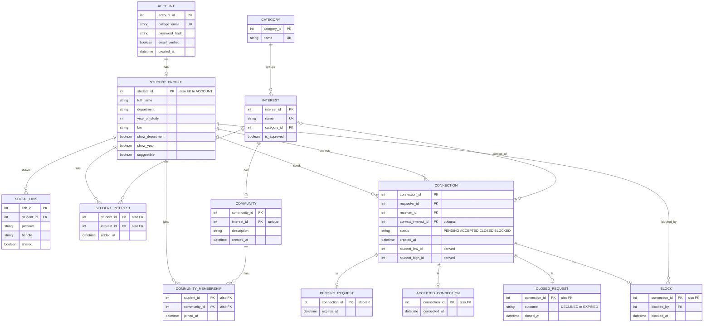

# Connore database design

Connore uses 13 MySQL tables defined in [schema.sql](../sql/schema.sql). The
model follows the supplied developer guide. The editable paired ER and EER
diagrams are in [Connore_ER_EER.drawio](diagrams/Connore_ER_EER.drawio); both use
the same entities, with Connection at the centre. The EER specializes Connection
into its four states.

## Relational ER reference

The editable diagram is also available in [connore-er.mmd](connore-er.mmd).

## Mapping to the application

| Feature | Tables |
| --- | --- |
| Account registration and login | `account` |
| Student introduction and visibility settings | `student_profile` |
| Private or shared social handles | `social_link` |
| Interest catalog and selected interests | `category`, `interest`, `student_interest` |
| Communities and membership | `community`, `community_membership` |
| Requests, connections, and blocking | `connection`, `pending_request`, `accepted_connection`, `closed_request`, `block` |

The simple frontend calls a single Java API and uses the same database for
profiles, matching, communities and connections.

## How to read the guide alongside the implementation

The following details explain the SQL cardinalities and business rules:

- **Account and profile:** the diagram shows one-to-one. The guide’s page 27 says the profile is created on the first profile save, so a newly registered account temporarily has no profile. The shared primary/foreign key permits at most one profile per account.
- **Interest and community:** the diagram shows one-to-one. The unique foreign key on `community.interest_id` permits at most one community per interest. The guide’s catalog setup rule calls for one community for each interest; the SQL alone does not force every interest to already have a community. The explicit interest catalog loader creates a community for each approved catalog interest and preserves existing community records.
- **Connection states:** each connection is intended to have exactly one subtype row matching its status. The separate zero-or-one subtype edges do not, by themselves, enforce this rule. `ConnectionDao` changes the subtype and status together through transactions used by `ConnectionService`.
- **Student pairs:** generated low/high student IDs and their unique key represent both request directions as one connection pair. The check constraint prevents a student connecting to themselves.
- **Interest context:** a connection may have no context interest; `context_interest_id` is nullable.
- **Memberships and selected interests:** composite primary keys prevent a student joining the same community or selecting the same interest twice.

The compact active catalog contains 48 interests across eight categories.
`InterestCatalog --sync` marks interests outside that list inactive, retaining
their IDs, student selections, memberships and connection references. Queries
for the current catalog, matches and community browser include only approved
interests.
